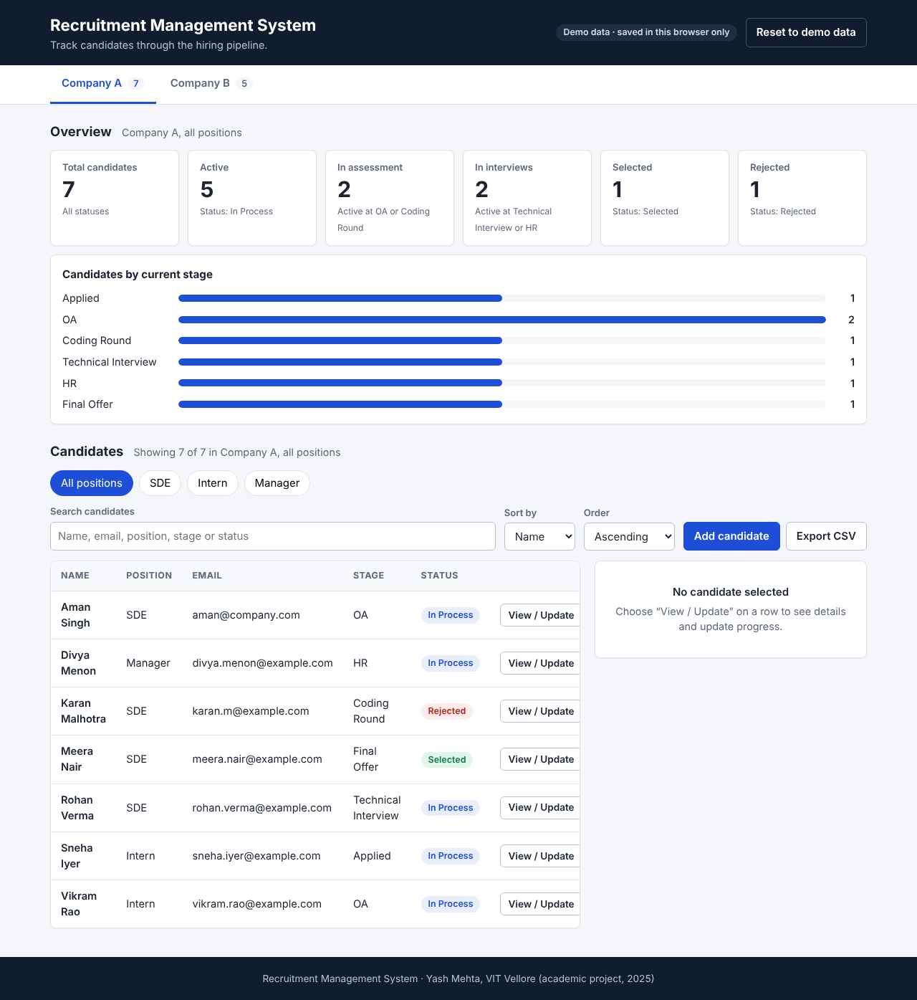
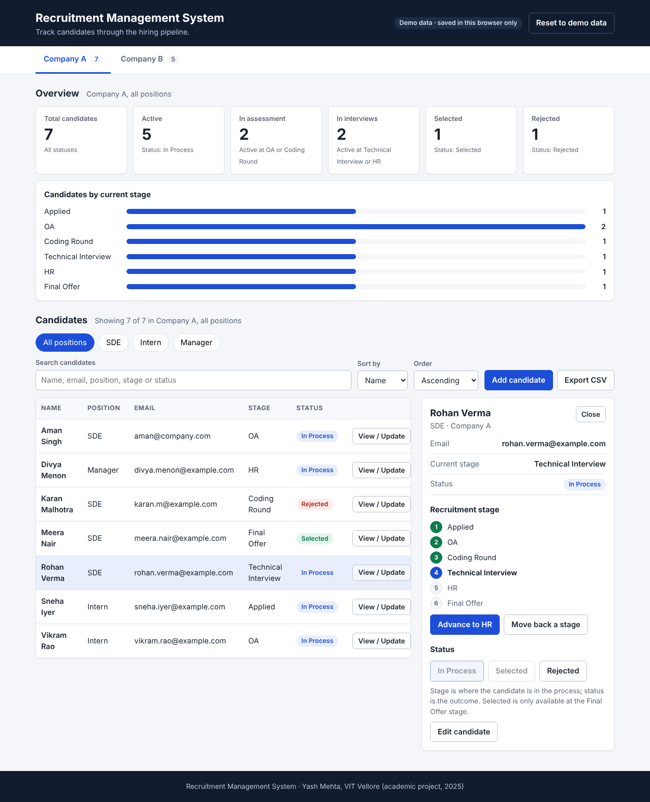
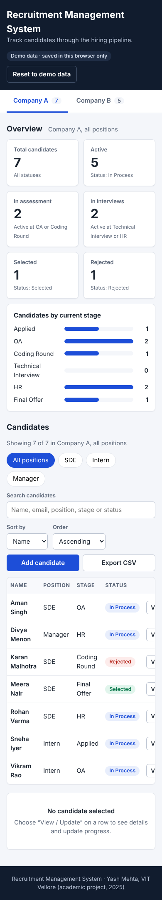

# Recruitment Management System (RMS)

A React + Vite dashboard for tracking job candidates through a hiring pipeline: filter by company and position, search, move candidates between stages, record outcomes, and export the current view to CSV.

> **Scope, stated plainly:** RMS is a **frontend-only demo**. There is no backend, database, authentication or multi-user sync. Candidate data is synthetic, lives in React state, and is saved only in **your own browser's `localStorage`**. Changes are not shared between users or devices. See [Architecture](#architecture) and [Limitations](#limitations).

Originally built as a cloud-computing project at VIT Vellore (October 2025) and hosted as a static site on Amazon S3. The cloud deployment is documented in [docs/deployment-aws-s3.md](docs/deployment-aws-s3.md).



| Candidate details and stage tracker | Mobile layout |
| --- | --- |
|  |  |

All screenshots were captured from the running app with synthetic data.

## Features

Everything below is implemented and covered by the automated tests or a browser check (see [docs/testing.md](docs/testing.md)).

- **Overview metrics** computed from the data: total, active, in assessment, in interviews, selected, rejected, plus a count per stage.
- **Company tabs and position filters**, with a visible summary of what is showing and a "Clear filters" action.
- **Search** across name, email, position, stage and status; works together with the filters.
- **Sortable candidate table** (name, position, stage in workflow order, status) with status badges and empty states.
- **Candidate detail panel** with a stage tracker, stage advance / move-back, and status controls.
- **Validated transitions**: stage changes only while a candidate is *In Process*; *Selected* only at *Final Offer*.
- **Add and edit candidates** with validation and duplicate detection (same email, company and position).
- **CSV export** of the rows currently shown, with quoted fields and spreadsheet formula-injection protection.
- **Browser persistence** (versioned `localStorage`) and a **Reset to demo data** button.

## Recruitment workflow

A candidate has a **stage** (where they are) and a **status** (the outcome so far).

```
Stages:  Applied → OA → Coding Round → Technical Interview → HR → Final Offer
Status:  In Process  ⇄  Rejected          (reopen any time)
         In Process  →  Selected          (only at Final Offer)
         Selected    →  Rejected | In Process
```

Reaching *Final Offer* does not mean a candidate is selected; a recruiter must set the status explicitly. Details, and how these map to the stage names in the October 2025 report, are in [docs/features-and-workflows.md](docs/features-and-workflows.md).

## Tech stack

React 18 · Vite 7 · plain CSS · Vitest + React Testing Library (tests). No runtime dependencies besides React.

## Architecture

```
Browser
 └─ React SPA (static files)
     ├─ App.jsx ─ filters, search, sort, selection, feedback
     ├─ useApplicants ─ applicant list (React state) ──▶ localStorage (this browser only)
     ├─ lib/applicants.js ─ pure rules: filter, sort, metrics, transitions, validation
     └─ lib/csv.js ─ CSV building and download
```

| Layer | What it is | Shared between users? |
| --- | --- | --- |
| React state | In-memory list while the tab is open | No |
| `localStorage` (`rms.applicants.v1`) | Saved copy in your browser | No (per browser profile) |
| Backend / database | **Does not exist** | n/a |

Full description: [docs/architecture.md](docs/architecture.md).

## Getting started

**Prerequisites:** Node.js **22.12 or newer** and npm. (Vite 7 itself needs Node 20.19+ or 22.12+; the test runner, Vitest 5, needs 22.12+.)

```bash
git clone https://github.com/yash-mehta13/Recruitment-Management-System.git
cd Recruitment-Management-System
npm install
npm run dev        # http://localhost:5173
```

### Scripts

| Script | What it does |
| --- | --- |
| `npm run dev` | Start the Vite dev server |
| `npm run build` | Production build into `dist/` |
| `npm run preview` | Serve the built `dist/` locally |
| `npm test` | Run the test suite once |
| `npm run test:watch` | Run tests in watch mode |

### Configuration

None required. The app reads no environment variables and calls no external services. The Vite `base` is `./` so the build works from a bucket root or a sub-folder.

## Exporting CSV

Use **Export CSV** above the table. It exports exactly the candidates currently shown (company, position filter and search, in the current sort order) with columns `Name, Company, Position, Email, Current Stage, Status`. The file is named like `rms-applicants_company-a_sde_2026-01-05.csv`. Values starting with `=`, `+`, `-`, `@`, tab or carriage return are prefixed with `'` so spreadsheets do not execute them as formulas. The button is disabled when nothing matches.

## Testing

```bash
npm test
```

Unit tests cover filtering, sorting, transitions, validation, metrics, CSV escaping and storage fallback; component tests drive the UI end to end. Details and gaps: [docs/testing.md](docs/testing.md).

## Deployment

The October 2025 report describes hosting on Amazon S3 static website hosting (bucket `recruitmentmanagementsystem`, region `eu-north-1`). The historical URL documented there was:

`http://recruitmentmanagementsystem.s3-website.eu-north-1.amazonaws.com`

**That endpoint is no longer live.** When checked on 2026-10-20 it returned HTTP 404 `NoSuchBucket`. There is currently no live demo. To deploy your own copy, follow [docs/deployment-aws-s3.md](docs/deployment-aws-s3.md) (this repository does not deploy anything automatically).

## Limitations

- No backend, database, authentication, roles or audit trail.
- Data is per-browser; clearing site data deletes it; nothing syncs.
- Demo data is synthetic. Do **not** enter real candidate information into a publicly hosted copy.
- Companies and positions are fixed in `src/data/data.js`; candidates cannot be deleted.

More in [docs/limitations-and-roadmap.md](docs/limitations-and-roadmap.md).

## Security and privacy

A static site cannot protect data from the person using the browser, and an S3 public-read bucket exposes every file to everyone. See [docs/security-and-privacy.md](docs/security-and-privacy.md) and [SECURITY.md](SECURITY.md).

## Project structure

```
.
├── index.html                 Vite entry
├── vite.config.js             Vite + Vitest configuration
├── public/                    Static assets (favicon, robots.txt)
├── src/
│   ├── main.jsx               React bootstrap
│   ├── App.jsx                Page composition and state
│   ├── constants.js           Stages, statuses, storage key
│   ├── components/            Presentational components
│   ├── hooks/useApplicants.js Applicant state + persistence
│   ├── lib/                   applicants.js, csv.js, storage.js (+ tests)
│   ├── data/data.js           Synthetic demo companies and candidates
│   ├── styles/main.css        All styles
│   └── test/setup.js          Test setup
└── docs/                      Documentation and screenshots
```

## Documentation

[Overview](docs/project-overview.md) · [Architecture](docs/architecture.md) · [Features and workflows](docs/features-and-workflows.md) · [Data model](docs/data-model.md) · [Testing](docs/testing.md) · [AWS S3 deployment](docs/deployment-aws-s3.md) · [Security and privacy](docs/security-and-privacy.md) · [Limitations and roadmap](docs/limitations-and-roadmap.md) · [Decisions](docs/decisions.md) · [Contributing](CONTRIBUTING.md) · [Changelog](CHANGELOG.md)

## License

No license file has been added to this repository, so no open-source license is granted. The repository owner should choose a license (for example MIT) and add a `LICENSE` file if reuse is intended.

## Author

Created by [yash-mehta13](https://github.com/yash-mehta13) (Yash Mehta), Department of Electronics and Communication Engineering, Vellore Institute of Technology, Vellore, under the guidance of Dr. Sasikumar P. Based on the October 2025 project report *Recruitment Management System* (Advanced Cloud Computing).
